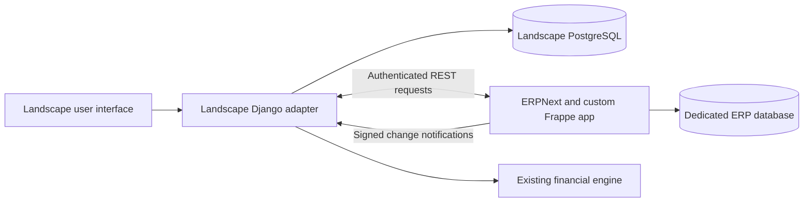

# ERPNext integration with Landscape — technical assessment

Prepared: October 4, 2026 (America/Phoenix)

This is a research assessment based on source inspection and official documentation. The user clarified on October 4 that this is purely a research exercise: Landscape was designed for underwriting rather than management. Integration and pilot descriptions below are hypothetical, with no implementation planned or authorized. No application code, database, accounting records, or deployed services were changed; no runtime integration was tested.

## Recommendation and product constraint

Run ERPNext as an optional accounting service, with a small custom Frappe app and a Landscape Django adapter. Landscape remains responsible for underwriting, development modeling, scenarios, valuation, and its existing user experience. ERPNext owns accounting documents and the posted ledger.

The current product decision is **D-2026-09-29-NO-ACTUALS-IN-UI** in the canonical Landscape decisions ledger. It preserves underwriting and saved budget versions and removes dedicated actuals columns from the proposed interface. This assessment preserves that decision: accounting results could become an explicitly selected, dated version or supporting input, without introducing an actuals dashboard by default. The user has asked about feasibility, not authorized a reversal of this product direction.

The earlier scope question has been superseded by the user's research-only clarification. The optional project-accounting companion described here is a hypothetical architecture for comparison, not an adopted product direction.

## Verified starting point

| Item | Finding | Evidence |
|---|---|---|
| Requested repository | Public fork of `frappe/erpnext`; its only returned branch is `develop`. | [Repository metadata](https://api.github.com/repos/Greggwolin/erpnext), [branches](https://api.github.com/repos/Greggwolin/erpnext/branches) |
| Fork divergence | The comparison returned `ahead_by: 0`, `behind_by: 2061`. Its head is the upstream June 29, 2026 development snapshot, not a real-estate customization. Counts are as inspected on October 4 and will change. | [Upstream comparison](https://api.github.com/repos/frappe/erpnext/compare/develop...Greggwolin:develop) |
| Fork version | `17.0.0-dev`; package requires Python `>=3.14` and Frappe `>=17.0.0-dev,<18.0.0`. | [Version](https://github.com/Greggwolin/erpnext/blob/c26ad9fc3699026a3f203ba295d7fdf051570b16/erpnext/__init__.py), [dependencies](https://github.com/Greggwolin/erpnext/blob/c26ad9fc3699026a3f203ba295d7fdf051570b16/pyproject.toml) |
| Landscape architecture | Next.js/React frontend, primary Django REST backend, Neon PostgreSQL, separate financial calculation services. | Local `CLAUDE.md`, `package.json`, `backend/requirements.txt` |
| Existing financial foothold | Budget model, actual-cost model, project/division references, contact/vendor links, and report code exist. These are reuse candidates, not proof of a working accounting connector. | Local financial and contacts models and views |
| Existing connector | No ERPNext/Frappe integration was found in the targeted application and project-ledger searches. This was not an exhaustive audit of every file or previous chat. | Targeted local searches |
| License | Repository metadata identifies ERPNext as GPL-3.0. Distribution and any code-derived customization need a licensing review for the chosen packaging model. API separation alone is not a legal determination. | [Repository license metadata](https://api.github.com/repos/Greggwolin/erpnext) |

Choose a maintained release and matching Frappe version before implementation. GitHub's `releases/latest` returned `v15.121.6`; that endpoint alone does not establish the complete support matrix or recommended major release. There is no demonstrated need to start from this frozen development snapshot.

## Proposed separation

ERPNext is a Frappe application, not a Django library to import into Landscape. Operate it with its own dependencies and site database. The official container setup includes web processes, Redis connections, queue workers, scheduler, and persistent site storage. These are additional operating responsibilities even if the visible interface stays in Landscape. Database compatibility must be verified against the selected release; do not assume either that ERPNext must always use MariaDB or that this fork can safely share Landscape's Neon schema. [Frappe apps](https://docs.frappe.io/framework/user/en/basics/apps), [sites](https://docs.frappe.io/framework/user/en/basics/sites), [official container configuration](https://github.com/frappe/frappe_docker/blob/main/compose.yaml).

Frappe supplies REST access for document types and token authentication, plus configurable webhooks with an optional HMAC signature. Those provide integration mechanisms; Landscape still needs its own mapping, authorization, retry, and reconciliation logic. [REST documentation](https://docs.frappe.io/framework/user/en/api/rest), [webhooks](https://docs.frappe.io/framework/user/en/guides/integration/webhooks).

## Data ownership and mapping

| Landscape concept | Proposed ERPNext representation | Work required |
|---|---|---|
| Customer cabinet/account | Separate Frappe site per customer as a starting design | Confirm ownership and sharing rules; do not confuse ERP Company with customer isolation. |
| Legal entity/SPV | Company | A Landscape project may span entities; avoid a blanket project-to-company mapping. |
| Development/property project | Project | Durable external IDs and explicit project association. |
| Area, phase, parcel, building, unit | Cost Center tree or custom dimensions/DocTypes | Decide required granularity; preserve Landscape's division hierarchy. |
| Cost category | Account plus a separate mapping to Landscape categories | Account codes and planning categories need not correspond one-to-one. |
| Vendor contact | Supplier and linked Contact/Address | Define master-data ownership and duplicate handling. |
| Approved purchasing | Purchase Order or selected contractual document | Distinguish original commitment from the remaining unbilled balance. |
| Posted costs | Selected GL/source-document lines | Define accounting basis, posting date, currency, tax, capitalized cost treatment, credits, and reversals. |
| Budget versions | Versioned import/snapshot with source links and as-of date | Preserve underwriting assumptions; establish a reviewed import policy. |

ERPNext already supports Project and Cost Center dimensions, with configurable additional dimensions. This is a useful foundation for phase/parcel tagging; it does not establish a turnkey land-development data model. [Accounting dimensions](https://docs.frappe.io/erpnext/accounting-dimensions).

For an accrual-cost comparison, a vendor invoice and its later payment must not both become the same project expense. Cash movement should be represented separately when used in a cash-based forecast. Likewise, original purchase commitments cannot simply be added to invoiced costs without deducting the billed portion. These definitions must be chosen with the accounting owner before importing production records.

## Landscape implementation footholds and gaps

- `backend/apps/financial/models.py`: `BudgetItem` maps to `core_fin_fact_budget`; `ActualItem` maps to `core_fin_fact_actual`, with project, division, optional budget-line link, period, amount, and JSON metadata. No dedicated ERP source-key uniqueness constraint is defined in the inspected actual model. Add a connector mapping/import ledger with enforceable deduplication rather than relying on JSON metadata alone.
- `backend/apps/financial/views.py`: the inspected actual-items `by_project` action calls the ownership-filtered queryset and reads `core_fin_fact_actual` through `ActualItem`. Its variance action queries budget and actual models directly; it needs a specific authorization audit before being used in a customer accounting integration.
- `backend/apps/reports/generators/rpt_20_budget_vs_actual.py`: the inspected preview path directly queries budget and actual fact tables. Its column assumptions differ from the inspected actual ORM model. Confirm the live database schema and canonical reporting path before reuse. No live database checks were performed in this assessment.
- `backend/apps/contacts/models.py`: cabinet and cabinet-scoped contacts exist. Align those boundaries with project ownership and ERP credentials; a global ERP service account must not allow cross-customer access.
- The budget model has a `budget_version` field, while the project ledger records a budget-version object. The authoritative version creation/switching path was not traced in this assessment. Trace it before drafting exact import contracts or changing calculations.
- New Landscape integration endpoints belong in Django under the repository's current architecture direction. New accounting functionality should not extend the legacy Next.js API surface.

## What changes the effort

| Scope | Relative effort | Main work |
|---|---|---|
| Optional data import, one project, existing ERP screens for accountants | Contained pilot | Release setup, company/project/category mapping, dated import, source links, reconciliation. |
| Reliable customer connector | Substantial integration | Site provisioning, credentials, customer isolation, background jobs, retries, cancellation/amendment handling, monitoring, support. |
| All bill entry, purchasing, approvals, payment status, and reports inside Landscape | Major product addition | New accounting screens and permissions, complete document lifecycle, audit trail, onboarding and support. |
| Real-estate operating suite | Broad domain customization | Requirements for retainage, change orders, lien waivers, lender draws, multi-entity allocation, and property-specific operations. Validate each against the chosen ERP release before claiming it is missing or included. |

These are qualitative judgments, not calendar estimates or price quotations. Cost depends principally on the visible workflow scope, number of customers/entities, historical migration, specialist requirements, and ongoing hosting, updates, and accounting support.

## Recommended first proof and verification

Use one existing Landscape project and a separate test ERP company/site. Map a small representative chart/category set and a phase. Import selected posted cost data into a dated, reviewed version or supporting record while retaining the current underwriting interface.

Acceptance evidence should include a source transaction link for every imported line, matching totals by company/project/category/period, no duplicates after replay, correct credit/cancellation treatment, recoverable interruption, and denial of access from another Landscape owner. Verify that invoice cost and payment cash movement are not double-counted and that baseline budgets remain unchanged. If selecting the imported version feeds forecasts, verify the affected cash flow and valuation outputs against known examples.

Then decide whether users need additional commitment data, finance workflows within Landscape, or only recurring accounting snapshots. Do not expand to an accounting replacement before the first proof demonstrates useful information and trustworthy totals.

## Downstream impact

Changes can affect budget versions, category rollups, lifecycle-stage budgets, financial reports, cash-flow timing, debt sizing, valuation, and Landscaper tool reads. The main risks are wrong entity/phase attribution, accrual versus cash confusion, duplicate costs, overwriting underwriting assumptions, and customer-boundary violations. Full implementation requires tracing the selected budget-version path and documenting which calculation consumers use the imported data.

## Research limits

The fork metadata, version/dependency files, branch comparison, official documentation, and selected local code paths were inspected. Portions of large local status ledgers were sampled; the specific September 29 product decision was read directly. The broader status file flags its own staleness, so historical deadlines were not treated as current. No ERP site was launched, sample transactions posted, full repository audit completed, or current customer requirements confirmed.

## Features unlikely to apply to a developer outsourcing construction

The following are applicability judgments, not ERPNext vendor claims. They assume a developer hiring contractors and consultants rather than operating factories, retail stores, or material-processing businesses.

| ERPNext feature | Likely relevance | Important exception |
|---|---|---|
| Manufacturing: bills of materials, production work orders, workstations, job cards, production planning and factory quality checks | Usually low; these describe production of finished goods. | Modular/prefabricated construction or an owned manufacturing operation. |
| Point of sale: checkout, cash sessions, retail loyalty rewards | Usually very low for development accounting. | An independently operated retail business. |
| Detailed physical stock: serial numbers, batches, expiry tracking and warehouse handling | Usually low if contractors procure and hold materials. Physical stock workflows should not be conflated with accounting for development property. | Direct procurement, material storage, self-performed construction, or equipment/material traceability. |
| Manufacturing subcontracting: materials sent to a supplier and processed goods returned | Usually low for ordinary development contracts. Its familiar name does not establish construction subcontract administration. | Owner-supplied materials processed into components by an outside manufacturer. |

Timesheets can be useful for internal labor allocation or billed development-management services. Asset accounting can be useful for owned equipment or retained fixed assets. Those are conditional, not blanket exclusions. The strongest accounting overlap remains general ledger, vendor bills/payments, purchasing, entity/project/cost classification, budgets and financial reports.

Sources: [manufacturing](https://docs.frappe.io/erpnext/manufacturing), [point of sale](https://docs.frappe.io/erpnext/point-of-sale), [serial and batch tracking](https://docs.frappe.io/erpnext/serial-and-batch), [subcontracting](https://docs.frappe.io/erpnext/subcontracting), [timesheets](https://docs.frappe.io/erpnext/timesheets), [asset capitalization](https://docs.frappe.io/erpnext/asset-capitalization).
